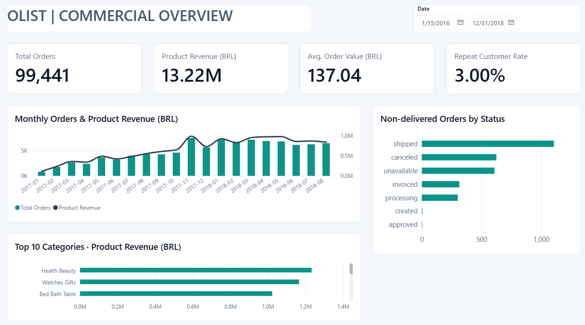
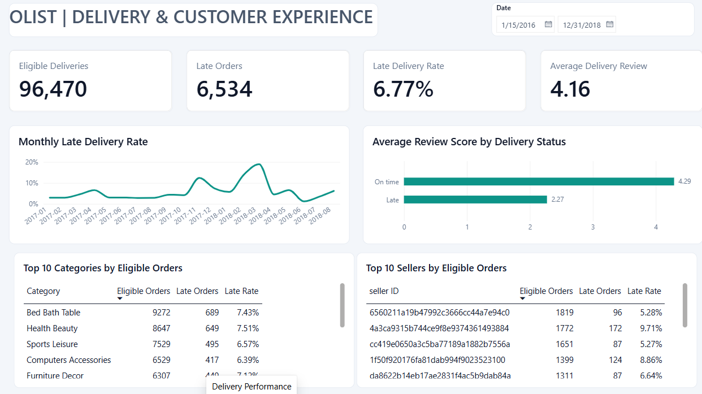

# Olist E-commerce & Delivery Analysis

SQL analysis and a two-page Power BI report covering 99,441 Brazilian e-commerce orders from 2016–2018. The project looks at sales, delivery delays, customer reviews, and repeat purchasing.

**Tools:** SQLite · DB Browser for SQLite · Power Query · DAX · Power BI Desktop

## Dashboard

### Commercial Overview

### Delivery Performance

[Download the Power BI report](powerbi/Olist_Ecommerce_Analysis.pbix)

## Main findings

| Metric | Result |
|---|---:|
| Total orders | 99,441 |
| Delivered orders | 96,478 |
| Delivered orders with both delivery dates | 96,470 |
| Late orders | 6,534 |
| Late delivery rate | 6.77% |
| Average review score: late orders | 2.27 / 5 |
| Average review score: on-time orders | 4.29 / 5 |
| Delivered product revenue | Approximately BRL 13.22 million |
| Average delivered order value | BRL 137.04 |
| Customers with delivered orders | 93,358 |
| Repeat customers | 2,801 (3.00%) |

Figures above use the full dataset period. Report values change with the purchase-date filter.

- Late orders received reviews about 2.02 points lower than on-time orders. This is an association, not evidence that delay alone caused the difference.
- Only 3.00% of customers with a delivered order placed another delivered order within the observed period. This is not a lifetime retention measure.
- Monthly orders and revenue grew substantially during 2017. The delivery report shows a pronounced late-rate peak around March 2018; identifying its cause would require further investigation.
- Health Beauty, Watches Gifts, and Bed Bath Table appear among the leading categories by delivered product revenue.
- Delivery performance varies across high-volume categories and sellers, giving a starting point for operational follow-up.

## Suggested actions

1. Investigate the March 2018 delivery spike by seller and route before changing delivery promises.
2. Prioritize sellers with both substantial order volume and elevated late rates; assess delay counts alongside percentages.
3. Test a post-delivery follow-up campaign for first-time buyers, then measure repeat purchasing over a fixed observation window.

These are proposed actions, not measured business improvements.

## Report pages

**Commercial Overview:** total orders, delivered product revenue, average order value, repeat customer rate, monthly orders and revenue, top categories by revenue, and non-delivered order statuses.

**Delivery Performance:** eligible deliveries, late orders, late rate, average review score, monthly late rate, reviews by delivery status, and the top 10 categories and sellers by eligible order volume.

The monthly charts show January 2017–August 2018. Sparse months outside this window remain in the dataset and full-period KPIs. All monthly measures use the order purchase month, including delivery rates.

## Definitions

- **Product revenue:** item prices from delivered orders, excluding freight. It is not Olist's commission or net revenue.
- **Average order value:** delivered product revenue divided by all delivered orders.
- **Late delivery:** actual delivery calendar date later than the estimated calendar date. Delivery later on the same date counts as on time.
- **Eligible delivery:** delivered order with both actual and estimated delivery dates. Eight delivered orders lack a required date and are excluded from delivery-rate calculations.
- **Review score:** reviews are averaged per order first, then across reviewed orders. Orders without a score are excluded from review averages.
- **Average Delivery Review:** mean order review score among eligible deliveries with reviews.
- **Repeat customer:** a `customer_unique_id` with at least two delivered orders in the selected purchase-date period. The rate divides these customers by customers with at least one delivered order in that period.
- **Category/seller delivery rates:** distinct orders within each group. A multi-category or multi-seller order can appear in several groups, so group counts are not additive.

SQL Q2b and Q4 rank by eligible delivered product revenue. The delivery-page tables rank by eligible order count. Their top-10 lists therefore need not match.

## Files

- [SQL views and analysis](sql/analysis.sql)
- [Power BI measures and calculated columns](powerbi/measures.dax)
- [Power BI theme](powerbi/Olist_Executive_Theme.json)
- [Data and setup notes](docs/data-setup.md)

## Data source

[Brazilian E-Commerce Public Dataset by Olist](https://www.kaggle.com/datasets/olistbr/brazilian-ecommerce), published by Olist on Kaggle. These are real marketplace orders from Brazil, not data from Noon, Talabat, or Careem.

The source dataset is licensed under [CC BY-NC-SA 4.0](https://creativecommons.org/licenses/by-nc-sa/4.0/). Raw CSV files and the SQLite database are not included. Download them from the source and follow the setup notes. Source data and adaptations remain subject to the source license.

## Limitations

The data is historical and does not represent current marketplace performance. Canceled and unavailable orders are separate statuses; other non-delivered statuses should not be treated as cancellations. The report measures whole-order delivery performance, so a late order does not establish which seller or carrier caused the delay. Repeat purchasing is limited to the dataset's observation window. Filtered rankings and averages can change as the selected period changes.
